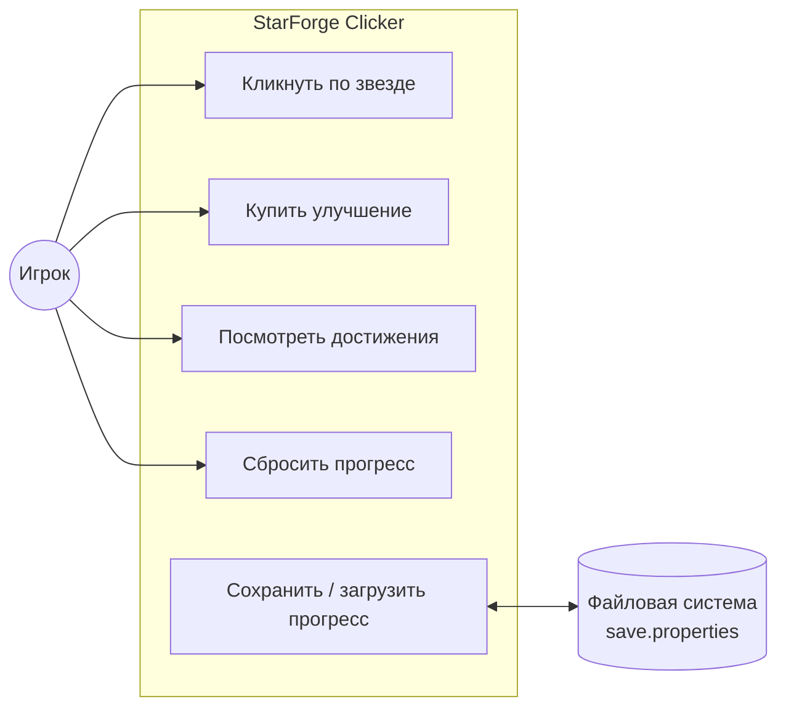
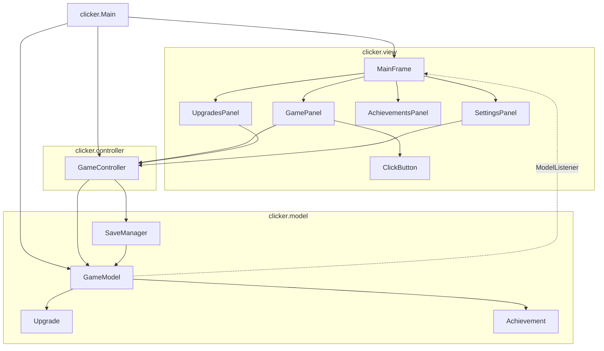
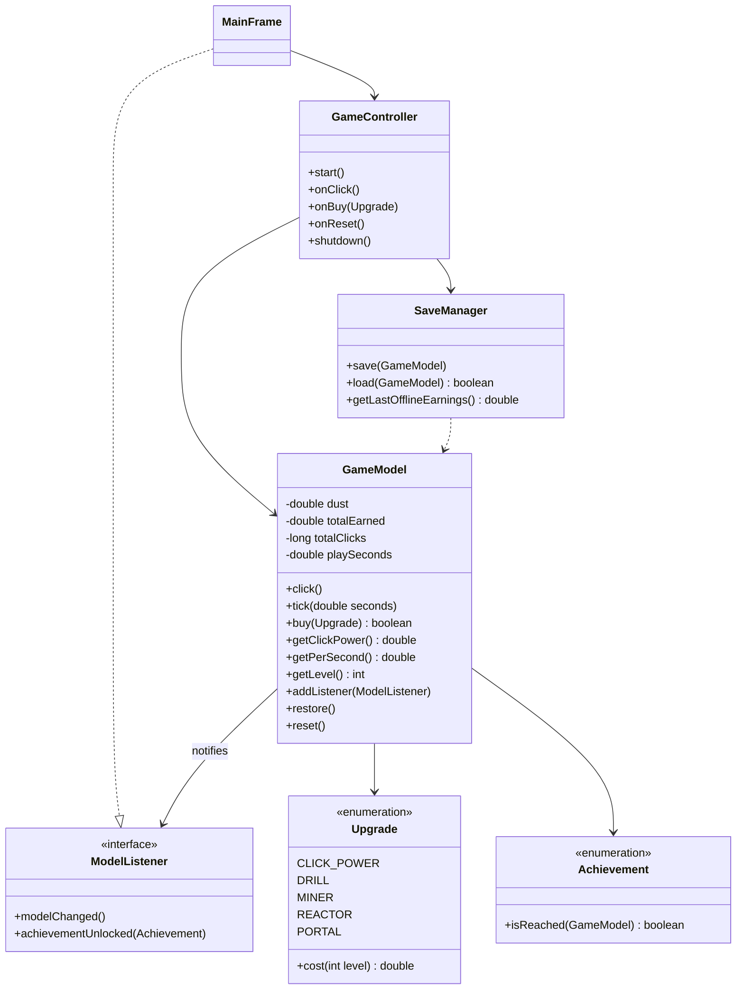
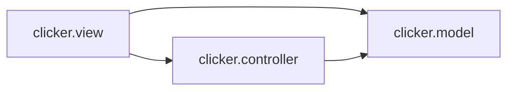
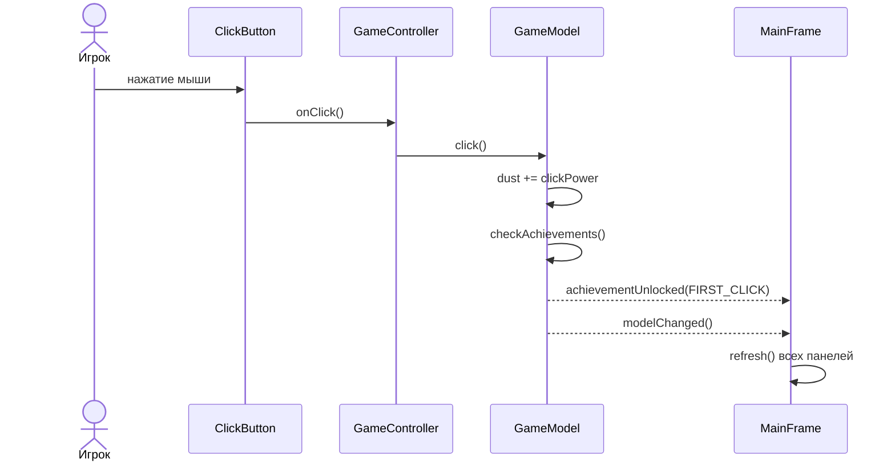
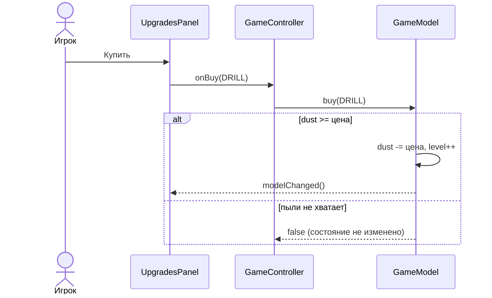
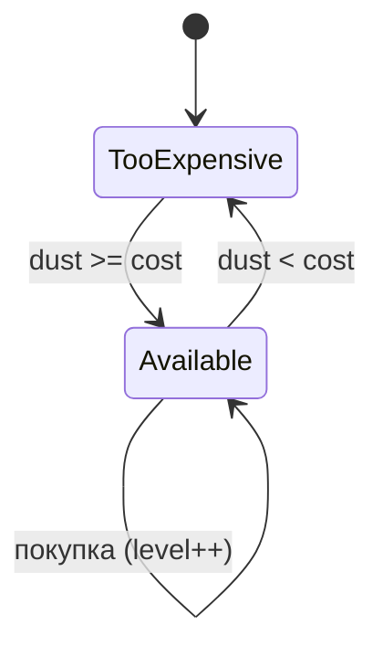
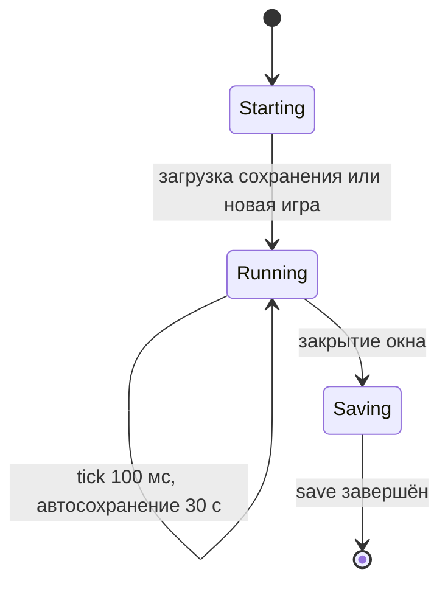
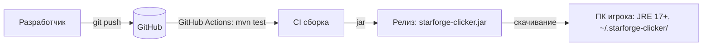

# Описание дизайна программного обеспечения

Для StarForge Clicker

Версия 0.3

Подготовил(а) _Ефлаков Дмитрий Дмитрийевич_

БГУИР, кафедра ЭВМ

_28.10.2026_

## Оглавление

* [1. Введение](#1-introduction)
* [2. Обзор дизайна](#2-design-overview)
* [3. Проектные представления](#3-design-views)
* [4. Решения](#4-decisions)
* [5. Приложения](#5-appendixes)

## История изменений

| Name | Date | Reason For Changes | Version |
|------|------|--------------------|---------|
| _<ФИО>_ | _<дата>_ | Первая версия SDD | 0.1 |
| _<ФИО>_ | _<дата>_ | Правки по итогам обсуждения с Заказчиком (раунд 1): разделено сохранение, изменены приоритеты | 0.2 |
| _<ФИО>_ | _<дата>_ | Правки по итогам раунда 2: компоненты Golden Star, Prestige, Sound | 0.3 |

---

## 1. Введение {#1-introduction}

### 1.1 Назначение документа {#11-document-purpose}

Документ описывает проектные решения десктопной игры-кликера StarForge Clicker: состав компонентов, их взаимодействие, данные и принятые архитектурные решения. Он предназначен разработчикам (реализация и сопровождение), преподавателю (оценка процесса) и Заказчику (понимание, из чего состоит продукт). Документ вытекает из бизнес-требований ([srs/srs.md](../srs/srs.md)) и системных требований ([srs/system-requirements.md](../srs/system-requirements.md)).

### 1.2 Область применения {#12-subject-scope}

Проектируется StarForge Clicker версии 0.x: однопользовательское офлайн-приложение для Windows, Linux и macOS на Java 17 (Swing). Игрок кликает по звезде, получает «звёздную пыль», покупает улучшения, получает достижения и повышает уровень; прогресс сохраняется локально.

Входит: игровая логика, графический интерфейс, локальное сохранение, офлайн-доход, сборка и тесты.
Не входит: сетевые функции, учётные записи, рейтинги, платежи, мобильные и веб-версии.

### 1.3 Определения, акронимы и сокращения {#13-definitions-acronyms-and-abbreviations}

| Term | Definition |
|------|------------|
| ADR | Architecture Decision Record — запись архитектурного решения |
| EDT | Event Dispatch Thread — единственный поток Swing, в котором работает интерфейс |
| MVC | Model-View-Controller — разделение на модель, представление и контроллер |
| SDD | Software Design Document — документ описания проектирования |
| SRS | Software Requirements Specification — спецификация требований |
| Tick | Периодический шаг игрового времени (100 мс) |
| Звёздная пыль | Основной игровой ресурс |
| Пассивный доход | Пыль в секунду, получаемая без кликов |

### 1.4 Ссылки {#14-references}

| Документ | Тип | Расположение |
|---|---|---|
| Бизнес-требования (SRS) | справочный | `srs/srs.md` |
| Системные требования | нормативный | `srs/system-requirements.md` |
| Протоколы архитектурных решений | нормативный | `adr/` |
| План итераций | справочный | `plan/iteration-plan.md` |
| Модель системы на SysML v2 | справочный | `srs/starforge-model.sysml` |

### 1.5 Обзор документа {#15-document-overview}

Раздел 2 определяет стейкхолдеров и выбранные точки зрения. Раздел 3 содержит проектные представления (идентификаторы вида `001-context`) со ссылками на требования и решения. Раздел 4 перечисляет решения, подробности — в `adr/`. Раздел 5 — приложения. Документ ведётся в Git; каждое изменение отражается в истории изменений.

---

## 2. Обзор дизайна {#2-design-overview}

### 2.1 Задачи стейкхолдеров {#21-stakeholder-concerns}

| Стейкхолдер | Основные задачи | Точки зрения / представления |
|---|---|---|
| Игрок | Отзывчивый интерфейс, не терять прогресс, понятная прогрессия | Context, Interaction, State dynamics, Information |
| Заказчик | Соблюдение сроков и бюджета, предсказуемый объём | Composition, Resources, Patterns |
| Разработчик | Простота изменения, тестируемость, расширяемость | Logical, Dependency, Interface, Patterns, Algorithm |
| Тестировщик | Возможность проверять логику без интерфейса | Logical, Interface, Algorithm |
| Преподаватель | Прослеживаемость требований → дизайн → решения | Все представления, раздел 4 |

### 2.2 Выбранные точки зрения {#22-selected-viewpoints}

Используются UML-диаграммы в нотации Mermaid (отображаются в GitHub) и таблицы.

#### 2.2.1 Контекст {#221-context}
Выбрана: определяет границы и акторов. Язык: диаграмма вариантов использования. Адресует: Игрока, Заказчика.

#### 2.2.2 Композиция {#222-composition}
Выбрана: показывает разбиение на пакеты MVC и внешние зависимости. Язык: диаграмма компонентов. Адресует: Заказчика, разработчика.

#### 2.2.3 Логическое представление {#223-logical}
Выбрана: статическая структура классов. Язык: диаграмма классов UML. Адресует: разработчика, тестировщика.

#### 2.2.4 Физическое представление {#224-physical}
Не используется: продукт работает на обычном ПК игрока, специальной аппаратной инфраструктуры нет.

#### 2.2.5 Структура {#225-structure}
Отдельное представление не выбрано: внутренняя организация подсистем показана в 002-composition и 003-logical, коннекторы MVC — в 011-patterns.

#### 2.2.6 Зависимости {#226-dependency}
Выбрана: контроль связанности пакетов. Язык: диаграмма пакетов. Адресует: разработчика.

#### 2.2.7 Информация {#227-information}
Выбрана: структура сохраняемых данных. Язык: таблица схемы. Адресует: игрока (сохранность), разработчика.

#### 2.2.8 Интерфейс {#228-interface}
Выбрана: контракты публичных классов. Язык: сигнатуры методов. Адресует: разработчика, тестировщика.

#### 2.2.9 Взаимодействие {#229-interaction}
Выбрана: порядок сообщений в сценариях «клик», «покупка», «сохранение». Язык: диаграммы последовательности. Адресует: разработчика, игрока.

#### 2.2.10 Алгоритм {#2210-algorithm}
Выбрана: формулы цены, уровня, офлайн-дохода. Язык: математическая запись и псевдокод. Адресует: разработчика, тестировщика.

#### 2.2.11 Динамика состояний {#2211-state-dynamics}
Выбрана: состояния улучшения и жизненный цикл приложения. Язык: диаграмма конечных автоматов. Адресует: разработчика, игрока.

#### 2.2.12 Параллелизм {#2212-concurrency}
Выбрана: политика потоков (все таймеры работают в EDT). Язык: таблица. Адресует: разработчика.

#### 2.2.13 Паттерны {#2213-patterns}
Выбрана: MVC, Observer, перечисления с поведением. Язык: таблица. Адресует: разработчика, Заказчика.

#### 2.2.14 Развёртывание {#2214-deployment}
Выбрана: упаковка в jar и запуск на JRE. Язык: диаграмма развёртывания. Адресует: Заказчика, игрока.

#### 2.2.15 Ресурсы {#2215-resources}
Выбрана: память, файловая система, таймеры. Язык: таблица. Адресует: Заказчика, разработчика.

---

## 3. Проектные представления {#3-design-views}

### 001-context

- **Title**: Контекст системы
- **Viewpoint**: Context
- **Реализует требования**: FR-001…FR-012, NFR-010 (работа без сети)
- **Решения**: [ADR-0001](../adr/0001-java-swing-desktop.md)



Единственный внешний «сервис» — локальная файловая система. Сетевых взаимодействий нет.

### 002-composition

- **Title**: Состав системы
- **Viewpoint**: Composition
- **Реализует требования**: NFR-006 (тестируемость), NFR-005 (переносимость)
- **Решения**: [ADR-0002](../adr/0002-mvc-active-model-observer.md)



Запланированные компоненты (итерации 2-3): `GoldenStarService` (случайный бонус), `PrestigeService`, `SoundPlayer`. Внешних библиотек в основном коде нет (только JDK); JUnit 5 используется в тестах.

### 003-logical

- **Title**: Логическая структура классов
- **Viewpoint**: Logical
- **Реализует требования**: FR-001…FR-009
- **Решения**: [ADR-0002](../adr/0002-mvc-active-model-observer.md)



### 004-dependency

- **Title**: Зависимости пакетов
- **Viewpoint**: Dependency
- **Реализует требования**: NFR-006 (модель тестируется без GUI)



Правило: пакет `clicker.model` не импортирует `javax.swing`, `clicker.view` и `clicker.controller`; проверяется при ревью и тестами модели без GUI. Исключение: `GameController` использует `javax.swing.Timer`.

### 005-information

- **Title**: Данные сохранения
- **Viewpoint**: Information
- **Реализует требования**: FR-006, FR-007, FR-008, NFR-002
- **Решения**: [ADR-0003](../adr/0003-properties-file-persistence.md)

Файл `~/.starforge-clicker/save.properties` (резервная копия — `save.properties.bak`), формат `java.util.Properties`.

| Ключ | Тип | Смысл |
|---|---|---|
| `dust` | double ≥ 0 | текущая пыль |
| `totalEarned` | double ≥ dust | добыто за всё время (определяет уровень) |
| `totalClicks` | long ≥ 0 | число кликов |
| `playSeconds` | double ≥ 0 | время в игре |
| `savedAt` | long (epoch sec) | момент сохранения (для офлайн-дохода) |
| `upgrade.<NAME>` | int ≥ 0 | уровень каждого улучшения |
| `achievements` | CSV | имена полученных достижений |

Целостность: значения проверяются при загрузке; при ошибке разбора модель не изменяется, берётся `.bak`.

### 006-interface

- **Title**: Публичные интерфейсы ключевых классов
- **Viewpoint**: Interface
- **Реализует требования**: FR-001…FR-009

| Класс | Метод | Контракт |
|---|---|---|
| `GameModel` | `click()` | dust += clickPower; totalClicks++; проверка достижений; `modelChanged` |
| `GameModel` | `tick(double s)` | при s ≤ 0 ничего не делает; иначе начисляет `getPerSecond()·s` |
| `GameModel` | `boolean buy(Upgrade)` | true и списание цены, если dust ≥ цены; иначе false без изменений |
| `GameModel` | `restore(...)` | устанавливает состояние без уведомлений о достижениях |
| `SaveManager` | `save(GameModel)` | запись через временный файл; предыдущая версия → `.bak`; бросает `IOException` |
| `SaveManager` | `boolean load(GameModel)` | true, если прочитан основной файл или `.bak`; повреждённые данные модель не меняют |
| `ModelListener` | `modelChanged()`, `achievementUnlocked(a)` | вызываются в потоке, изменившем модель (EDT) |
| `GameController` | `onClick/onBuy/onReset/shutdown` | единственная точка входа действий пользователя |

### 007-interaction

- **Title**: Сценарии взаимодействия
- **Viewpoint**: Interaction
- **Реализует требования**: FR-001, FR-003, FR-004, FR-006

Сценарий «клик» (успешный путь, с получением достижения):



Сценарий «покупка» (путь отказа — не хватает пыли):



Кнопка «Купить» при нехватке пыли отключена, поэтому ветка отказа в интерфейсе недостижима; она защищает модель при вызове не из GUI.

Сценарий «автосохранение»: каждые 30 с `GameController` вызывает `SaveManager.save(model)`; при `IOException` сообщение пишется в stderr, игра продолжается.

### 008-algorithm

- **Title**: Игровые формулы и алгоритмы
- **Viewpoint**: Algorithm
- **Реализует требования**: FR-002, FR-003, FR-005, FR-008

| Величина | Формула |
|---|---|
| Цена улучшения | `cost(L) = ceil(baseCost · 1.15^L)`, L — текущий уровень улучшения |
| Сила клика | `1 + Σ clickBonus(u) · level(u)` |
| Доход в секунду | `Σ perSecondBonus(u) · level(u)` |
| Уровень игрока | `1 + floor(sqrt(totalEarned / 100))` |
| Прогресс уровня | `(earned − 100(L−1)²) / (100L² − 100(L−1)²)` |

Офлайн-доход (псевдокод):
```
elapsed = clamp(now - savedAt, 0, 8 часов)
offline = dustPerSec * elapsed * 0.5
model.addOfflineEarnings(offline)
```
Все операции выполняются за время, пропорциональное числу видов улучшений и достижений (5 и 12), то есть практически мгновенно. Параметры 1.15, 100, 0.5 и 8 ч вынесены в константы.

### 009-state-dynamics

- **Title**: Динамика состояний
- **Viewpoint**: State dynamics
- **Реализует требования**: FR-003, FR-006





Достижение имеет два состояния: закрыто → получено (необратимо, кроме сброса прогресса).

### 010-concurrency

- **Title**: Политика потоков
- **Viewpoint**: Concurrency
- **Реализует требования**: NFR-002, NFR-001
- **Решения**: [ADR-0004](../adr/0004-single-thread-swing-timer.md)

| Активность | Поток | Механизм |
|---|---|---|
| Интерфейс, клики, покупки | EDT | события Swing |
| Игровое время (tick 100 мс) | EDT | `javax.swing.Timer` |
| Автосохранение (30 с) | EDT | `javax.swing.Timer` |
| Загрузка при старте | EDT (`invokeLater`) | синхронно, файл мал |

Вся работа с `GameModel` идёт в одном потоке, блокировки не нужны, гонок нет. Допущение: запись файла сохранения быстрая (порядка миллисекунд). Если сохранение вырастет, его переносят в отдельный поток с копией состояния (см. ADR-0004).

### 011-patterns

- **Title**: Применённые паттерны
- **Viewpoint**: Patterns

| Паттерн | Где | Зачем |
|---|---|---|
| MVC | `model` / `view` / `controller` | разделение логики и интерфейса |
| Observer | `GameModel` → `ModelListener` | обновление интерфейса без связи модели с GUI |
| Enum with behavior | `Upgrade`, `Achievement` | добавление улучшения или достижения без изменения ядра (BO-3) |
| Memento (упрощённо) | `SaveManager.save` и `GameModel.restore` | сохранение и восстановление состояния |

### 012-deployment

- **Title**: Развёртывание
- **Viewpoint**: Deployment
- **Реализует требования**: NFR-005, NFR-008, NFR-009
- **Решения**: [ADR-0001](../adr/0001-java-swing-desktop.md)



Запуск: `java -jar starforge-clicker-<версия>.jar`. Установщик не требуется.

### 013-resources

- **Title**: Использование ресурсов
- **Viewpoint**: Resources
- **Реализует требования**: NFR-001, NFR-004

| Ресурс | Оценка / ограничение |
|---|---|
| Память | ожидается менее 150 МБ (оценка, подлежит замеру); требование — не более 512 МБ |
| Диск | файл сохранения менее 2 КБ; запись раз в 30 с |
| ЦПУ | таймер 100 мс, обновление 3 панелей; нагрузка пренебрежимо мала |
| Таймеры | 2 (`tick`, автосохранение); при добавлении Golden Star — 3-й |
| Запуск | не более 3 с (SC-3) |

---

## 4. Решения {#4-decisions}

| ID | Название | Статус |
|---|---|---|
| ADR-0001 | [Java 17 и Swing для десктопного клиента](../adr/0001-java-swing-desktop.md) | принято |
| ADR-0002 | [MVC с активной моделью и паттерном Observer](../adr/0002-mvc-active-model-observer.md) | принято |
| ADR-0003 | [Локальное сохранение в .properties с резервной копией](../adr/0003-properties-file-persistence.md) | принято |
| ADR-0004 | [Однопоточная модель на Swing Timer](../adr/0004-single-thread-swing-timer.md) | принято |
| ADR-0005 | [Офлайн-доход: лимит 8 часов, коэффициент 0.5](../adr/0005-offline-income-policy.md) | принято |

---

## 5. Приложения {#5-appendixes}

- Модель системы на SysML v2: [`srs/starforge-model.sysml`](../srs/starforge-model.sysml)
- Мокапы интерфейса: `srs/img/mockup-*.png`
- Улучшения и достижения: `src/main/java/clicker/model/Upgrade.java`, `Achievement.java`
- Трассировка требований к представлениям и решениям: таблица в `srs/system-requirements.md`
