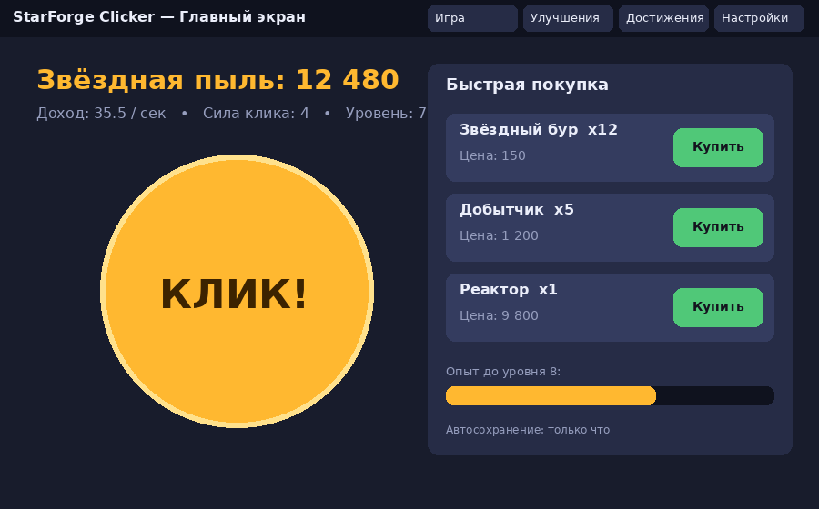
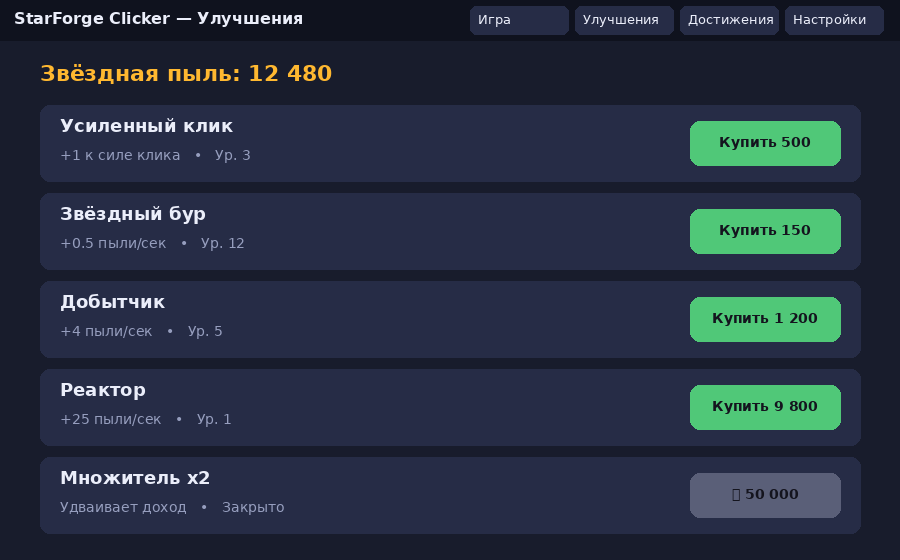
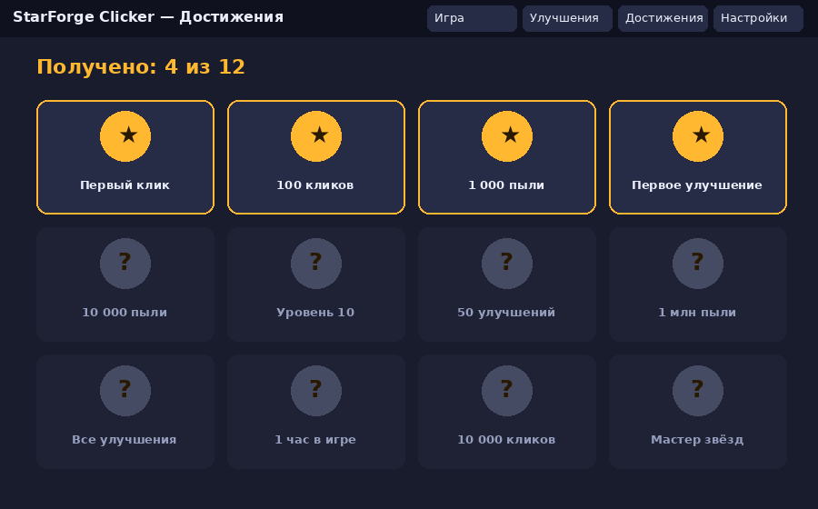

# Документ бизнес-требований: StarForge Clicker

| Поле | Значение |
|---|---|
| Проект | StarForge Clicker — десктопная игра-кликер |
| Тип проекта | Desktop-приложение |
| Язык разработки | Java 21 (JavaFX, Maven, JUnit 5) |
| Язык документации | Русский |
| Версия документа | 0.1 (черновик) |
| Заказчик | _Тарахович Лев Сергеевич_ |
| Менеджер проекта | _Ефлаков Дмитрий Дмитриевич_ |

## 1. Введение

### 1.1 Назначение документа
Документ фиксирует бизнес-требования к игре-кликеру StarForge Clicker: зачем она нужна, для кого, какие цели достигает и что входит в границы проекта.

### 1.2 Определения
| Термин | Значение |
|---|---|
| Кликер | Игра, где основное действие — многократные клики по объекту ради накопления ресурса |
| Звёздная пыль | Основной игровой ресурс |
| Пассивный доход | Пыль в секунду, получаемая без кликов |
| Улучшение | Покупаемый за пыль объект, увеличивающий силу клика или пассивный доход |
| Достижение | Награда за выполнение игрового условия |

## 2. Бизнес-требования

### 2.1 Предпосылки и возможности
Рынок казуальных игр-кликеров устойчив: игры просты и подходят для коротких сессий. Большинство десктопных кликеров — веб-обёртки или браузерные игры, требующие постоянного подключения. Возможность: офлайн-игра с нативным окном, локальным сохранением и без рекламы.

### 2.2 Бизнес-цели
| ID | Цель |
|---|---|
| BO-1 | Создать увлекательную офлайн-игру, удерживающую игрока за счёт прогрессии и достижений |
| BO-2 | Показать работоспособный продукт полного цикла (требования → разработка → тестирование) в рамках курса |
| BO-3 | Получить расширяемую основу (новые улучшения и достижения добавляются без переписывания ядра) |

### 2.3 Критерии успеха
| ID | Критерий | Цель |
|---|---|---|
| SC-1 | Средняя длительность игровой сессии у тестовых игроков | не менее 10 минут |
| SC-2 | Доля тестовых игроков, получивших ≥ 5 достижений | не менее 70 % |
| SC-3 | Время запуска приложения | не более 3 секунд |
| SC-4 | Потеря прогресса после штатного закрытия | 0 % |

### 2.4 Видение продукта
Для казуальных игроков, желающих расслабиться за короткой игрой, StarForge Clicker — десктопный кликер с понятной прогрессией, улучшениями и достижениями, работающий офлайн. В отличие от браузерных аналогов, не требует интернета и не показывает рекламу.

### 2.5 Бизнес-риски
| ID | Риск | Вероятность | Влияние | Снижение |
|---|---|---|---|---|
| R-1 | Игровой баланс слишком быстрый или слишком медленный | Высокая | Среднее | Вынести параметры в конфигурацию, провести playtest |
| R-2 | Игрокам быстро становится скучно | Средняя | Высокое | Достижения, уровни, новые улучшения |
| R-3 | Потеря сохранения при сбое | Низкая | Высокое | Автосохранение и резервная копия файла |
| R-4 | Нехватка времени на реализацию всех функций | Средняя | Среднее | Приоритизация (раздел 3.1) |

## 3. Границы проекта

### 3.1 Основные функции (высокоуровневые)
| ID | Функция | Приоритет |
|---|---|---|
| F-1 | Клик по главному объекту приносит пыль | Высокий |
| F-2 | Пассивный доход (пыль в секунду) | Высокий |
| F-3 | Магазин улучшений (клик и пассивный доход), цена растёт с уровнем | Высокий |
| F-4 | Система достижений с уведомлениями | Высокий |
| F-5 | Уровни игрока и опыт | Средний |
| F-6 | Автосохранение и загрузка прогресса (локальный файл) | Высокий |
| F-7 | Настройки (звук, сброс прогресса) | Низкий |
| F-8 | Офлайн-доход за время отсутствия игрока | Низкий |

### 3.2 Графические материалы (мокапы)
Мокапы выполнены в виде PNG; структурная модель интерфейса — на SysML v2 (`ui-model.sysml`).

| Экран | Файл |
|---|---|
| Главный экран |  |
| Улучшения |  |
| Достижения |  |

Ссылки: [main](img/mockup-main.png), [upgrades](img/mockup-upgrades.png), [achievements](img/mockup-achievements.png), [SysML v2](ui-model.sysml).

### 3.3 Ограничения и исключения
- Только desktop (Windows/Linux/macOS с JRE 21), без веб- и мобильной версий.
- Без сетевой игры, аккаунтов, рейтингов и внутриигровых покупок за реальные деньги.
- Без внешних сервисов; данные хранятся локально в JSON.
- Графика 2D, звук — минимальный.

## 4. Бизнес-контекст

### 4.1 Заинтересованные стороны
| Сторона | Интерес | Ожидания |
|---|---|---|
| Заказчик | Рабочая и интересная игра | Соответствие требованиям, соблюдение сроков |
| Игрок | Приятный геймплей | Понятный интерфейс, прогресс не теряется |
| Менеджер проекта / разработчик | Выполнить лабораторные курса | Чёткие требования, минимум переделок |
| Преподаватель | Оценка процесса | Документация, история коммитов и PR |

### 4.2 Приоритеты проекта
| Параметр | Ограничение / степень свободы |
|---|---|
| Срок | Фиксирован (семестр) |
| Функциональность | Гибкая: F-7 и F-8 могут быть отложены |
| Качество | Ключевое: стабильность и сохранение прогресса |
| Бюджет | Нет (учебный проект) |

